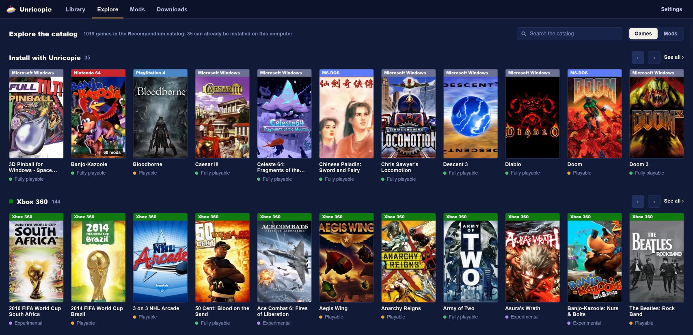
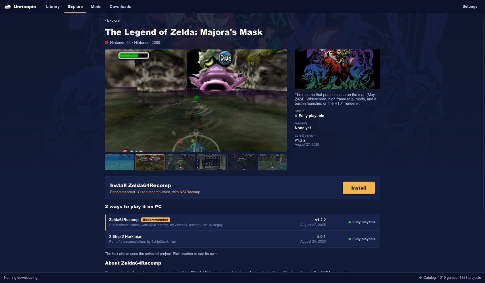
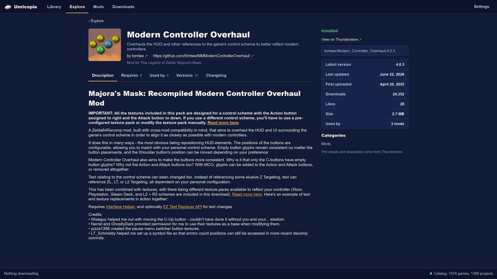

# Unricopie

Unricopie is the launcher of [Recompendium](https://recompendium.com/), the catalogue of console games running natively on PC. It installs catalogue projects from their official release, checks your copy of the game, and gets it ready to play, mods included.

**Download:** [Releases](../../releases) · **Page:** https://recompendium.com/unricopie

Unricopie never ships games or builds its own versions of the projects. Every project needs your own legal copy of the game; Unricopie checks it against the versions each project asks for and puts it where the game looks for it.



## New in 0.2

- **Linux.** An AppImage and a tar.gz for x86-64 (glibc 2.35 or newer). Games shipped as AppImages start even without FUSE; if a game needs a system library you don't have, Unricopie names it and gives the command to install it on your distribution (apt, dnf or pacman). It also unpacks releases that put an archive inside another.
- **Your copies from a folder.** Settings → *Your copies* looks for your ROMs and ISOs and keeps the ones you pick whose hash matches what a project asks for. Only the exact hash counts, never the file name.
- **Does it still need your copy?** A game's *What you need* tab says whether it reads your copy every time or only the first time (to build its own files), and how much space the game and your copy take.
- **Any published version.** The *Versions* tab lists a project's releases on GitHub; install an older one or switch to it, and the one you had is kept with your saves.
- **Checks before installing and playing.** Free disk space before downloading and before unpacking; your own Microsoft Defender scans every download before it's unpacked (nothing is installed if it finds a threat, and the result shows on the game's page); the Visual C++ runtime and Vulkan are checked before starting a game, with Microsoft's link when they're missing.
- **Command line.** `list`, `install`, `update`, `versions`, `copies`, `launch`, `path`, `add` and `remove-added`. `launch` waits until the game closes, so it works for Steam, Playnite and ES-DE shortcuts.
- **Projects outside the catalogue.** Settings → *Add a GitHub project* (or `unricopie add`) installs a repository the catalogue doesn't have, with the same checks, marked as not reviewed.
- **More games.** 20 new install recipes, among them Shadow the Hedgehog, Conker's Bad Fur Day Reloaded, Luigi's Mansion, Wind Waker HD, Monster Hunter Portable 3rd, Donkey Kong Country, Killzone Shadow Fall and Driveclub: 96 projects install on Windows and 68 on Linux. Recipes come from recompendium.com, so 0.1 gets them too.
- **macOS, on the way.** The core opens `.app` bundles, and `scripts/mac/` builds a universal app; packages come once it's tested on real Macs.

## What it does (0.2)

- **Installs from the source.** Downloads each project from the release its author publishes on GitHub and checks the download against GitHub's checksum.
- **Checks your copy.** Compares your copy with the versions the project accepts, stores it once in your library, and never modifies it.
- **Updates and rolls back.** Tells you when a project publishes a new version and updates it keeping your saves and settings. The previous version is kept, and you can go back to it.
- **The whole catalogue.** Explore shows every catalogue project with console filters: the ones Unricopie installs, with their button, and the rest, with a link to the project.
- **Thunderstore mods** for Zelda 64: Recompiled and Banjo: Recompiled: installed with their dependencies, in profiles, with load order by drag and drop, conflict handling (pick which mod wins), your own mods dropped on the window, and each profile's mod settings, including the ones you change inside the game.
- **Portable.** With an empty `portable.txt` next to `unricopie.exe`, everything lives in that folder: the launcher, the games, the saves, and the settings.
- **Finds your copies.** Settings → *Your copies* looks in a folder for your ROMs and ISOs and keeps the ones whose hash matches what each project asks for. A game's page also says whether it reads your copy every time or only the first time, and how much space it takes.
- **Any version.** A project's *Versions* tab lists its published releases: install an older one or switch to it, keeping the one you had.
- **Projects outside the catalogue.** Settings → *Add a GitHub project* installs a repository the catalogue doesn't have, with the same download checks; it's marked as not reviewed.
- **Checks before installing and before playing.** Free disk space before downloading, the local Microsoft Defender scan of each download before it's unpacked, and the Visual C++ runtime and Vulkan before starting a game (on Linux, the system libraries it needs, with the command to install them).
- **Command line.** `unricopie list`, `install`, `update`, `versions`, `copies`, `launch`, `path`, `add` and `remove-added`, for scripts and for Steam, Playnite or ES-DE shortcuts (see below).

## Command line

Run with arguments, `unricopie` doesn't open its window: it works from a terminal, a script or a shortcut.

```
unricopie list [--installed] [--json]            What it can install on this system, and what's installed
unricopie install <id> [--version <tag>]         Install the latest official release, or that one
unricopie update <id> [--version <tag>]          Update an installed project, or move it to that release
unricopie versions <id> [--json]                 The releases with a file for this system
unricopie copies <folder> [--dry-run] [--json]   Find your copies of the games in a folder
unricopie launch <id> [--no-wait] [-- …]         Start a game like the Play button does
unricopie path <id>                              Print the folder where it's installed
unricopie add <owner/repo|url> [--asset <name>] [--run <path>] [--json]
                                                 Install a GitHub project that isn't in the catalogue
unricopie remove-added <id>                      Forget a project you added by hand
```

`<id>` is what `unricopie list` shows (`recomps/zelda-majoras-mask`, or just `zelda-majoras-mask` when no other project shares it). `--data-dir <folder>` uses another library, and `--portable` the folder next to the program. `unricopie --help` has the details. Exit codes: 0 success, 1 error, 2 wrong usage.

- **`copies <folder>`** looks in a folder and its subfolders for your copies of the games (ROMs, ISOs) and stores the ones that match in your library, so you don't have to choose them one by one. A file only counts when its hash is the one the project asks for: nothing is guessed from file names, and your files are only read. `--dry-run` only reports what it found. It doesn't find copies that are a whole game folder or files inside zip or 7z archives, nor projects whose recipe has no hashes yet: choose those in the window.
- **`versions <id>`** lists the releases with a file for your system, newest first, and marks the installed one. `update <id> --version <tag>` moves an installed project to that release, newer or older, the same way as any update: the version you had is kept whole so you can go back to it, and your saves and settings are carried over.
- **`add <owner/repo>`** installs a project that isn't in the catalogue, from the latest official release of its GitHub repository (`unricopie add teeworlds/teeworlds`, or its `github.com` address). The download goes through the same checks as everything else (the size and SHA-256 GitHub publishes, the antivirus scan, disk space), but Unricopie hasn't reviewed the project: it doesn't know whether it works or what it needs, and it can't check your copy of the game. It picks the file of the release for your system by its name and, after unpacking it, the program that starts the game; when either isn't clear it doesn't guess: it lists the candidates and you run it again with `--asset <name>` or `--run <path>`. Installers (`.msi`, `setup.exe`) aren't supported, and a repository the catalogue already installs is refused, with the id to use instead. What you add shows up in `list` marked `[added by hand]` and in your library, and from then on `launch`, `update`, `versions` and `path` work with its id. `remove-added <id>` forgets it; it never deletes a game, so delete the game's folder first if it's installed. In the window, this is "Add a GitHub project" in Settings.

`launch` waits until the game closes, so Steam, Playnite or ES-DE can follow the session. To add a game to Steam: *Add a Non-Steam Game*, pick `unricopie.exe`, and in its properties set the launch options to `launch zelda-majoras-mask`.

In PowerShell, pass the output through a pipe (`unricopie list | Out-String`) or use `cmd /c unricopie list`: PowerShell doesn't collect the output of a windowed program on its own.

## Screenshots

| A game's page | A mod's page |
|---|---|
|  |  |

## Requirements

- **Windows:** 64-bit Windows 10 or 11.
- **Linux:** x86-64 with glibc 2.35 or newer (Ubuntu 22.04 or later, for example), as an AppImage or a tar.gz. AppImages run without FUSE.
- **macOS:** see `scripts/mac/` to build it; packages come later.

No account needed.

The first time, Windows SmartScreen may warn that it doesn't recognise the app, because it isn't signed yet: "More info" and "Run anyway".

Your games and settings go to `%LOCALAPPDATA%\Unricopie` on Windows and `~/.local/share/unricopie` on Linux, or next to the program in portable mode.

## What it connects to

Unricopie has no account, no telemetry, and no server of its own. It connects to:

- **recompendium.com** — the catalogue, the install recipes, the cover art, the players' reports on each project, and the notice of a new Unricopie version (it never updates itself);
- **GitHub** — each project's release information and downloads;
- **Thunderstore** — mod lists, icons, and downloads.

"How did it go?" opens a GitHub issue form in your browser, already filled in with the game, the version, your system, and your graphics card. Nothing is sent unless you submit it yourself.

## Building

With Rust stable (built with 1.96) and, on Windows, the MSVC toolchain with the Windows SDK (the icon and version info are compiled with `rc.exe`):

```
cargo build --release -p unricopie
```

The Windows package (`paquetes/Unricopie-<version>-windows-x64.zip`) is built with:

```
python scripts/empaquetar.py --recetas recetas.json
```

where `recetas.json` is the file published at `https://recompendium.com/unricopie/recetas.json`. The Linux packages (a tar.gz and an AppImage, built against glibc 2.35 inside an Ubuntu 22.04 container) need Docker:

```
python scripts/empaquetar.py --linux --recetas recetas.json
```

On a Mac, `bash scripts/mac/compilar.sh` builds a universal `Unricopie.app` (it needs the Xcode command line tools and Rust).

## Layout

| Folder | What it holds |
|---|---|
| `nucleo/` | The core library: recipes, downloads and checksums, your copy, installs, updates and rollback, portable mode, and mods (staging, profiles, load order, deployment). No interface. |
| `app/` | The interface, in [Slint](https://slint.dev), on top of the core. Texts are written in Spanish; the English translation lives in `app/lang/` (`traducir.py` checks that nothing is missing). |
| `banco/` | The test bench: installs, checks, and opens every recipe on a real machine. |
| `scripts/` | Packaging: Windows (`empaquetar.py`), Linux (`scripts/linux/`, with Docker) and macOS (`scripts/mac/`). |

## Licence

The code is free software under the **GNU General Public License v3.0 or later**: see [`COPYING`](COPYING).

The install recipes aren't part of this repository: Unricopie downloads them from recompendium.com, so they can be fixed and extended without a new release. The catalogue data comes from Recompendium (CC BY-SA 4.0).

Game names and trademarks belong to their owners. Unricopie isn't affiliated with any of them or with the projects it installs.

---

## En español

Unricopie es el launcher de [Recompendium](https://recompendium.com/): instala los proyectos del catálogo desde su versión oficial, comprueba tu copia del juego y lo deja listo para jugar, con sus mods. Nunca reparte juegos: cada proyecto necesita tu propia copia legal.

- **Descarga:** en [Releases](../../releases). Windows 10 u 11 de 64 bits, o Linux x86-64 con glibc 2.35 o posterior (AppImage o tar.gz). No pide cuenta.
- **Qué hace:** instala desde la fuente, comprueba tu copia, actualiza y vuelve atrás sin perder partidas, instala cualquier versión publicada, busca tus copias en una carpeta, dice si el juego necesita tu copia en cada partida y cuánto ocupa, comprueba el espacio, analiza cada descarga con Microsoft Defender, avisa si falta Visual C++, Vulkan o una librería de Linux, muestra todo el catálogo y maneja mods de Thunderstore (perfiles, orden arrastrando, conflictos, mods propios y sus ajustes). Modo portable con un `portable.txt` junto al programa.
- **Novedades de la 0.2:** Linux (AppImage y tar.gz), buscar tus copias en una carpeta, saber si el juego necesita tu copia en cada partida, instalar cualquier versión publicada, comprobar el espacio y analizar cada descarga con Microsoft Defender, avisar si falta Visual C++ o Vulkan, la línea de comandos, añadir proyectos de GitHub que no están en el catálogo y 20 recetas nuevas (96 proyectos en Windows y 68 en Linux).
- **Línea de comandos:** con argumentos no abre la ventana: `unricopie list`, `install <id>`, `update <id>`, `launch <id>` y `path <id>` (`unricopie --help`). `launch` espera a que se cierre el juego, así que sirve para añadirlo a Steam como juego externo, con `launch <id>` en sus opciones de lanzamiento.
- **A qué se conecta:** recompendium.com, GitHub y Thunderstore. Sin telemetría. «¿Cómo te fue?» abre un formulario de GitHub ya relleno, y solo se envía si lo envías tú.
- **Licencia:** el código es GPL-3.0 o posterior ([`COPYING`](COPYING)). Las recetas no están en este repositorio: se bajan de recompendium.com.
