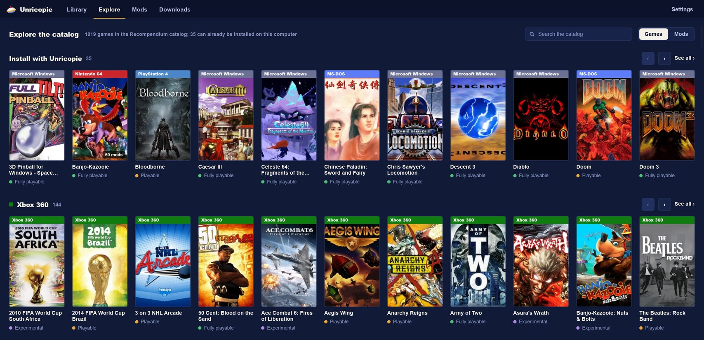
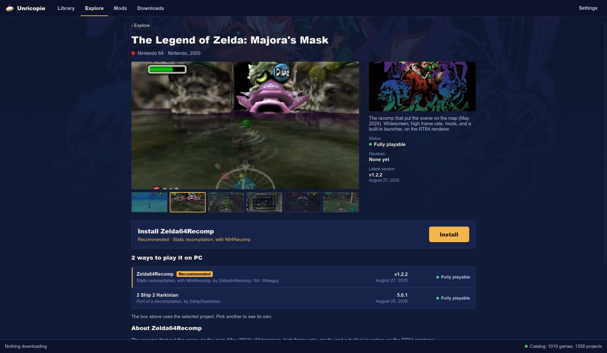
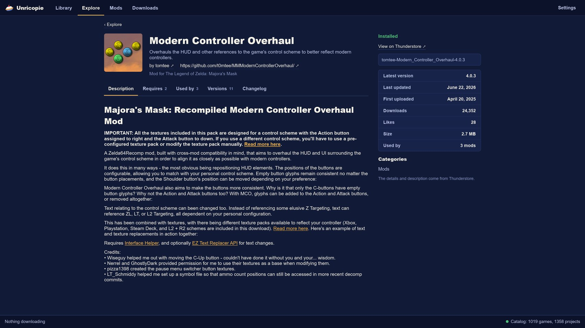

# Unricopie

Unricopie is the launcher of [Recompendium](https://recompendium.com/), the catalogue of console games running natively on PC. It installs catalogue projects from their official release, checks your copy of the game, and gets it ready to play, mods included.

**Download:** [Releases](../../releases) · **Page:** https://recompendium.com/unricopie

Unricopie never ships games or builds its own versions of the projects. Every project needs your own legal copy of the game; Unricopie checks it against the versions each project asks for and puts it where the game looks for it.



## What it does (0.1)

- **Installs from the source.** Downloads each project from the release its author publishes on GitHub and checks the download against GitHub's checksum.
- **Checks your copy.** Compares your copy with the versions the project accepts, stores it once in your library, and never modifies it.
- **Updates and rolls back.** Tells you when a project publishes a new version and updates it keeping your saves and settings. The previous version is kept, and you can go back to it.
- **The whole catalogue.** Explore shows every catalogue project with console filters: the ones Unricopie installs, with their button, and the rest, with a link to the project.
- **Thunderstore mods** for Zelda 64: Recompiled and Banjo: Recompiled: installed with their dependencies, in profiles, with load order by drag and drop, conflict handling (pick which mod wins), your own mods dropped on the window, and each profile's mod settings, including the ones you change inside the game.
- **Portable.** With an empty `portable.txt` next to `unricopie.exe`, everything lives in that folder: the launcher, the games, the saves, and the settings.

## Screenshots

| A game's page | A mod's page |
|---|---|
|  |  |

## Requirements

64-bit Windows 10 or 11. Linux (AppImage) comes later. No account needed.

The first time, Windows SmartScreen may warn that it doesn't recognise the app, because it isn't signed yet: "More info" and "Run anyway".

Your games and settings go to `%LOCALAPPDATA%\Unricopie`, or next to the program in portable mode.

## What it connects to

Unricopie has no account, no telemetry, and no server of its own. It connects to:

- **recompendium.com** — the catalogue, the install recipes, the cover art, the players' reports on each project, and the notice of a new Unricopie version (it never updates itself);
- **GitHub** — each project's release information and downloads;
- **Thunderstore** — mod lists, icons, and downloads.

"How did it go?" opens a GitHub issue form in your browser, already filled in with the game, the version, your system, and your graphics card. Nothing is sent unless you submit it yourself.

## Building

With Rust stable (built with 1.96) and, on Windows, the MSVC toolchain with the Windows SDK (the icon and version info are compiled with `rc.exe`):

```
cargo build --release -p unricopie
```

The Windows package (`paquetes/Unricopie-<version>-windows-x64.zip`) is built with:

```
python scripts/empaquetar.py --recetas recetas.json
```

where `recetas.json` is the file published at `https://recompendium.com/unricopie/recetas.json`.

## Layout

| Folder | What it holds |
|---|---|
| `nucleo/` | The core library: recipes, downloads and checksums, your copy, installs, updates and rollback, portable mode, and mods (staging, profiles, load order, deployment). No interface. |
| `app/` | The interface, in [Slint](https://slint.dev), on top of the core. Texts are written in Spanish; the English translation lives in `app/lang/` (`traducir.py` checks that nothing is missing). |
| `banco/` | The test bench: installs, checks, and opens every recipe on a real machine. |
| `scripts/` | Packaging. |

## Licence

The code is free software under the **GNU General Public License v3.0 or later**: see [`COPYING`](COPYING).

The install recipes aren't part of this repository: Unricopie downloads them from recompendium.com, so they can be fixed and extended without a new release. The catalogue data comes from Recompendium (CC BY-SA 4.0).

Game names and trademarks belong to their owners. Unricopie isn't affiliated with any of them or with the projects it installs.

---

## En español

Unricopie es el launcher de [Recompendium](https://recompendium.com/): instala los proyectos del catálogo desde su versión oficial, comprueba tu copia del juego y lo deja listo para jugar, con sus mods. Nunca reparte juegos: cada proyecto necesita tu propia copia legal.

- **Descarga:** en [Releases](../../releases). Windows 10 u 11 de 64 bits; Linux, más adelante. No pide cuenta.
- **Qué hace:** instala desde la fuente, comprueba tu copia, actualiza y vuelve atrás sin perder partidas, muestra todo el catálogo y maneja mods de Thunderstore (perfiles, orden arrastrando, conflictos, mods propios y sus ajustes). Modo portable con un `portable.txt` junto al programa.
- **A qué se conecta:** recompendium.com, GitHub y Thunderstore. Sin telemetría. «¿Cómo te fue?» abre un formulario de GitHub ya relleno, y solo se envía si lo envías tú.
- **Licencia:** el código es GPL-3.0 o posterior ([`COPYING`](COPYING)). Las recetas no están en este repositorio: se bajan de recompendium.com.
